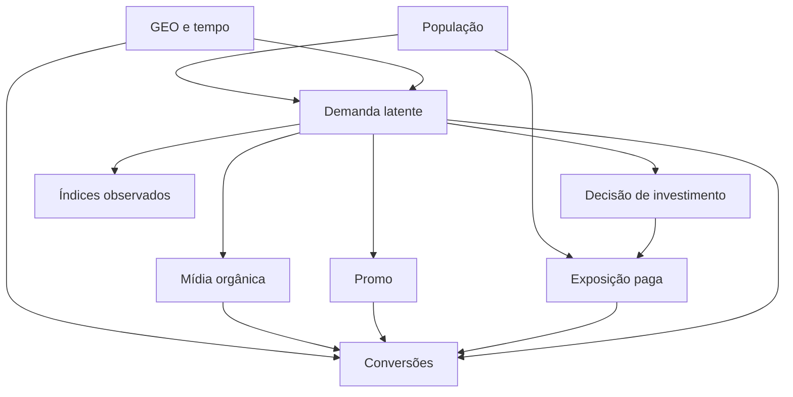

# Dos endereços observados às hipóteses que o modelo deverá enfrentar

Entrega 1 de 5 — desenho e configuração científica. Consulta e execução local: 26/10/2026.

Este capítulo é a ponte entre o guia **O que o total nacional não conta**, fornecido em anexo, e a primeira estimação futura. Seu ponto de chegada é um protocolo auditável. Não há posterior, ROI estimado ou recomendação de investimento nesta entrega. A leitura deve seguir este capítulo e depois o notebook `01_DESENHO_CIENTIFICO_COLAB.ipynb`. Os CSVs e YAMLs permitem conferir a implementação sem criar narrativas concorrentes.

## 1. O que queremos aprender — e o que já sabemos

**O que investigaremos.** Em que medida preservar a informação geotemporal melhora a estimação, precisão e estabilidade dos efeitos incrementais de mídia frente a uma especificação nacional? Marketing Mix Modeling (MMM) é a modelagem do resultado em função da mídia e de outros fatores. GEO identifica um mercado; KPI é o indicador de resultado, aqui `conversions`.

**Evidência da EDA.** Os capítulos 6–9 mostram que tamanho populacional explica boa parte da diferença de nível, mas permanecem movimentos locais de mídia. O capítulo 18 conclui que existe informação adicional potencial, sem provar sua utilidade para inferência. Precisamos decidir como preservar essa informação sem converter variação em causalidade por definição.

**Intuição e formulação.** Somar quarenta partituras mostra o volume da orquestra; não revela automaticamente qual instrumento produziu cada mudança. O modelo hierárquico compartilha informação entre mercados, admitindo diferenças. A distribuição posterior será proporcional à verossimilhança (*likelihood*, compatibilidade probabilística dos dados com os parâmetros) vezes a *prior* (distribuição anterior à atualização). Compartilhar informação não cria uma intervenção aleatória.

**Perguntas operacionais para as entregas seguintes:**

| Pergunta | Hipótese operacional | Evidência futura que pode contrariá-la |
|---|---|---|
| A informação atualiza os efeitos? | Posterior difere da prior e é estável a perturbações justificadas | Intervalos continuam dominados pela prior ou mudam substancialmente |
| GEO ajuda em comparação alinhada? | Incerteza ou estabilidade melhora sem perda material de adequação | Intervalos menores apenas por priors distintas; piora de diagnóstico |
| Channel2 oferece suporte? | Há atividade suficiente para aprender contribuição e persistência | Posterior pouco informativa, alta sensibilidade, forte confusão com Channel3 |
| Channel3 se separa do tempo? | Contribuição permanece estável com flexibilidade temporal plausível | Baseline absorve ou devolve contribuição conforme os knots |
| Existe heterogeneidade estimável? | Diferenças GEO sobrevivem ao pooling e à incerteza | Intervalos de contrastes amplos e heterogeneidade perto de zero |
| Curvas não lineares são informativas? | Dados informam `alpha` e `ec` no suporte histórico | Curvas dependem quase inteiramente da prior ou de extrapolação |
| Extremos mudam conclusões? | Estimandos são estáveis em análise de influência controlada | Casos isolados alteram substancialmente sinal, magnitude ou incerteza |

**Escolha proposta.** Usar o painel bruto, manter os cinco canais, orgânico, dois índices e `Promo`; construir um candidato GEO explícito. Não exigir que GEO vença. Melhora de precisão sem convergência, suporte e estabilidade não será considerada evidência favorável. Diferenças relativas de 20% em estimandos ou de 10 pontos percentuais em probabilidades serão alertas de materialidade para revisão, não limiares universais de verdade.

**Limite e Entrega 2.** Sintético não significa que a verdade causal esteja disponível. O mecanismo gerador e seus efeitos verdadeiros não foram recuperados como ground truth. Não se pode avaliar validade causal externa, campanhas reais ou lift experimental. A próxima entrega começa com revisão das priors e verificações preditivas anteriores à posterior, seguida de G0/G1 somente quando os gates aplicáveis forem satisfeitos.

## 2. A ponte rastreável da EDA

Cada linha abaixo separa observação descritiva de escolha futura. Os capítulos referem-se ao guia anexado, cujo SHA-256 está em `provenance.json`; links internos antigos não foram considerados arquivos locais desta entrega. A EDA não foi refeita.

| ID | Achado — OBSERVADO NA EDA | Origem | Limitação | Pergunta | ESCOLHA PROPOSTA | Experimento futuro | Evidência necessária |
|---|---|---|---|---|---|---|---|
| E01 | População × KPI ≈0,97 | 6 | Associação de escala | Nível domina efeitos? | Entradas brutas; scaling interno | GEO_HET | Efeitos e erros por tamanho |
| E02 | 68% da variância do KPI entre GEOs | 8 | Não é contribuição causal | Quanto sobra localmente? | Interceptos GEO e tempo | G0/K1 | Baseline e resíduos |
| E03 | 65%–79% de resíduos two-way per capita na mídia | 9 | Pode conter ruído/confundimento | Informação é utilizável? | Manter GEO | GEO_NAT | Estimandos alinhados |
| E04 | Sincronização mediana ≈0,03 | 7 | Não prova independência | Pooling é adequado? | Hierarquia, não 40 modelos isolados | GEO_HET | Heterogeneidade e contrastes |
| E05 | Mix acumulado semelhante; calendário local distinto | 11–12 | Acumulação apaga dinâmica | Qual variação identifica efeitos? | Preservar semanas | GEO_NAT | Sensibilidade GEO/nacional |
| E06 | Channel2 com ≈64,3% zeros | 12 | Ausência não é randomização | Há suporte no holdout? | Manter canal; auditar atividade | C2_SPARSE | Cobertura e prior/posterior |
| E07 | Channel3 ≈2,7% zeros e 40% do gasto | 10,12,14 | Exposição contínua pode confundir tempo | Mídia compete com baseline? | Sensibilidade temporal | C3_CONTINUOUS | Estabilidade com knots |
| E08 | C2/C3 two-way ≈0,45 | 13 | Transformações mudam associação | Contribuições se distinguem? | Avaliar efeitos individuais/conjuntos | C2_SPARSE | Correlação posterior e incerteza |
| E09 | C4/concorrência two-way ≈0,48 | 13 | Sufixo control não prova papel causal | Controle é confundidor? | DAGs alternativos | C1 | Estabilidade e mecanismo plausível |
| E10 | Controles têm sinais positivos/negativos | 13 | Unidades desconhecidas | São índices intensivos? | Não truncar nem dividir por população | C1 | Sensibilidade de escala |
| E11 | Promo contínua, ≈47% zero | 13 | Natureza da intervenção desconhecida | Qual contraste é coerente? | Baseline zero, hipótese explícita | C3 | Suporte e definição substantiva |
| E12 | Defasagens 0–8 exploratórias | 14 | Não estimam carryover | Persistência é identificável? | max_lag=8 candidato | A1–A4 | Alpha, cauda e estabilidade |
| E13 | Extremos preservados | 16 | Raridade não é erro | Há influência indevida? | Não excluir nem winsorizar | INFLUENCE | Mudança dos estimandos |
| E14 | MeridianEDA tinha seis REVIEW | 16 | Prior/EDA não é posterior | Diagnósticos persistem no modelo? | Preservar ressalvas | G0 | PPC, baseline, resíduos |
| E15 | VIF sem redundância extrema | 15 | Não garante identificação não linear | Hill/adstock confundem sinais? | Não remover por VIF isolado | P/K/A | Estabilidade das contribuições |
| E16 | Não há verdade causal observada | Epílogo, D | Não mede validade externa | O que a simulação permite concluir? | Linguagem condicionada | Todas | Limitações explícitas |

**Intuição.** Cada achado funciona como uma pergunta para o modelo, não como uma resposta que o modelo deve reproduzir. **AINDA NÃO IDENTIFICÁVEL:** incrementalidade, retorno, utilidade efetiva de GEO e heterogeneidade causal. Na Entrega 2 a matriz receberá evidências de G0/G1, sem reescrever retrospectivamente as hipóteses para combinar com resultados.

## 3. Estimandos: definir a pergunta antes de calcular

Queremos comparar o que seria esperado sob duas intervenções, mantendo explicitamente o restante do cenário. Seja `g` um dos 40 mercados sintéticos, `t` uma semana, `m` um canal e `θ` os parâmetros. Seja `μ_gt(x;θ)` a expectativa de conversões sob exposição `x`. O horizonte histórico T tem 156 semanas. A ausência de pré-histórico de mídia exige reconhecer o efeito de borda nas primeiras oito semanas; uma análise futura poderá reportar também horizonte comum após esse aquecimento, sem apagar o original.

Para um conjunto fixo A de mercados/semanas:

\[
\Delta_m(A;\theta)=\sum_{(g,t)\in A}\{\mu_{gt}(x;\theta)-\mu_{gt}(x^{(-m)};\theta)\}.
\]

`x^{(-m)}` zera a exposição do canal m no horizonte de intervenção definido, preservando os demais componentes. É preciso incluir a história defasada relevante e declarar se efeitos após o fim da janela entram no numerador. A referência inicial futura é a janela histórica disponível e seus efeitos nela; não é retorno vitalício. Os intervalos serão calculados sobre o mesmo contraste em cada draw posterior, nunca subtraindo limites de intervalos separados.

| Estimando futuro | Definição/unidade | Nível, horizonte e contrafactual | Saída candidata e incerteza | Requisito/limite |
|---|---|---|---|---|
| Incrementalidade paga/orgânica | Δ acima, conversões | GEO e soma dos 40, T; canal zerado | Analyzer.incremental_outcome com escala KPI explicitada; quantis 2,5%/97,5% | Hipóteses causais e suporte; API analítica validar na entrega pertinente |
| Parcela incremental | Δ / ΣY observado, adimensional | Mesmo A e T | Transformar draws; denominador observado declarado | Não é divisão contábil obrigatória de Y; baseline e contrastes precisam ser coerentes |
| Eficiência por gasto | Δ / Σspend, conversões/unidade de gasto | Canal pago, mesma janela | Razão por draw | Não chamar de retorno monetário; orgânico sem spend não tem ROI |
| ROI monetário | Σr_gt Δ_gt / Σspend | Mesma população e horizonte; r é receita por conversão | Analyzer.roi apenas após conferir unidades e opções | Receita e gasto na mesma unidade; sem moeda inventada; pendente |
| mROI | Derivada do resultado incremental em relação ao gasto | Pequena perturbação proporcional, mix GEO/tempo mantido | Analyzer.marginal_roi, configuração futura verificada | Mapeamento gasto→impressões e restrições; diferente do ROI médio |
| Adstock | α e janela L, α adimensional; L em semanas | Canal, história temporal | Draws de alpha_m/alpha_om | L fixo não é parâmetro aprendido; lag exploratório não escolhe L |
| Saturação | ec na escala transformada e slope adimensional | Canal no suporte observado | Draws ec; slope inicial fixo em 1 | Não alegar aprendizado de slope quando determinístico |
| Heterogeneidade | Dispersão dos efeitos entre GEOs | 40 GEOs do painel | eta e efeitos derivados por draw | Coeficiente, contribuição e ROI têm escalas distintas |
| Contraste GEO | Δ_g/pop_g − Δ_h/pop_h | Horizonte igual; mercados selecionados antes do resultado | Distribuição do contraste, probabilidade de diferença positiva | Múltiplas comparações; não ranking ingênuo |
| Sensibilidade | Mudança de centro, intervalo e probabilidade entre specs | Estimando comum, T | Tabela por modelo separada | Não combinar draws de modelos distintos como uma posterior |
| GEO × nacional | Diferença em estimandos agregados e sua precisão | Mesmos 40 mercados e T | Relatórios paralelos em escala nacional | Agregação não linear e priors impedem isolamento automático do efeito GEO |

**Distinção decisiva.** Ajuste preditivo mede representação de dados; inferência associativa resume o modelo; identificação causal exige pressupostos adicionais; decisão comercial exige utilidade, custos e validade externa. Uma sequência não certifica a próxima. Na Entrega 2 avaliaremos sobretudo confiabilidade computacional e adequação, não orçamento ótimo.

## 4. Um DAG hipotético, não descoberto pela correlação

DAG é um grafo direcionado acíclico: setas representam relações causais assumidas. A EDA mostrou associações variáveis entre escalas (capítulos 13–15); isso exige explicitar o mecanismo que se imagina antes de selecionar controles.

O grafo representa uma hipótese em que os índices são proxies imperfeitos da demanda. **Não significa que condicioná-los bloqueie o caminho mídia ← decisão ← demanda → KPI.** Uma alternativa seria controles medirem confundidores suficientes; outra seria sentimento ser afetado por mídia (mediador), tornando seu ajuste uma mudança de efeito total para efeito condicionado. A base não resolve entre essas alternativas. A figura tampouco identifica o mecanismo sintético verdadeiro.

**Analogia.** Ajustar pela previsão de chuva não é o mesmo que observar toda condição meteorológica. Um índice pode ajudar e continuar deixando confundimento. `Promo` fica como tratamento contínuo, com zero como contraste inicial; orgânico pode compartilhar demanda com pago ou mediar seus efeitos. A interpretação depende da hipótese escolhida. População dimensiona o mercado; não é contribuição incremental de publicidade. Tempo acomoda variação compartilhada, mas não substitui confundidores locais.

| Pressuposto | Status | Evidência disponível | Risco se violado | Investigação futura |
|---|---|---|---|---|
| Consistência da intervenção | unknown | Impressões observadas; identidades anônimas | Mesmo volume pode representar ações diferentes | Limitar conclusão à exposição sintética |
| Ausência de confundimento condicional | unsupported | Dois índices, GEO e tempo | Atribuição causal enviesada | DAGs alternativos e sensibilidade C1–C3 |
| Positividade/suporte | partially assessable | Zeros e atividade por mercado | Contrafactual extrapolado | Cobertura, faixa histórica e curvas |
| Não interferência entre mercados | assumed | Baixa correlação não testa spillover | Efeito local mistura exposição externa | Explicitar limite; não inventar matriz espacial |
| Medição válida | partially assessable | Contrato físico passou | Grandezas podem não ter semântica comercial | Revisar unidade e mecanismo sintético |
| Estabilidade no período | assumed | 156 semanas; sem metadados de campanhas | Parâmetro constante mistura regimes | Resíduos e sensibilidade temporal |
| Índices são intensivos | assumed | Valores com sinal; sem unidade de volume | Scaling inadequado | Sensibilidade separada e documentação |
| Promo=0 significa ausência | assumed | Zero frequente e mínimo zero | Baseline não corresponde à intervenção | Revisão substantiva antes de inferência |
| Efeito pago/orgânico não negativo | assumed | log_normal, não evidência de sinal causal | Impede efeitos negativos reais | Avaliar implicações e alternativa justificada |

Nenhum teste de software valida o conjunto dessas hipóteses. A Entrega 2 deverá reportar resultados como condicionais a elas.

## 5. Dados: a origem precisa sobreviver à execução

**Investigação.** O capítulo 3 da EDA documenta integridade estrutural, e o apêndice D ressalva que a reescrita não reexecutou a análise. Recuperamos o CSV oficial em um commit fixo, em vez de assumir que uma descrição garante identidade.

**Escolha e evidência executada.** O CSV tem 966.498 bytes, 6.240 linhas e 20 colunas físicas. O SHA-256 é `d9ee016f7cd21f5c90b50da10a794af91a372b69f881d3caa266edd41fdafbf6`. A assinatura Git do conteúdo também coincide com o blob `855e25fe5f76cc895d458f456f7a1d45ba5d87b8` retornado pela árvore oficial. A cópia pequena foi versionada com a licença Apache-2.0 original. O carregador verifica o hash antes de ler e rejeita substituição silenciosa. O commit do dataset e o commit da release de API são distintos e constam em `data/metadata/provenance.json`.

**Contrato físico e semântico completo:**

| Campo | Domínio e tipo | Papel no Meridian / unidade | Tratamento |
|---|---|---|---|
| Índice exportado `Unnamed: 0` | Inteiros 0…6239 | Nenhum | Remover da cópia somente após comprovar sequência |
| geo | Texto Geo0…Geo39 | Coordenada GEO | Preservar identidade; não mapa real |
| time | ISO, semanas regulares | Coordenada temporal | 2021-01-25…2024-01-15; 156 datas |
| conversions | Real finito ≥0, decimais | kpi; conversões simuladas | Não arredondar; `kpi_type=non_revenue` |
| population | Real finito >0 e constante por GEO | population; escala sintética | Um valor por GEO no tensor |
| Channel0…4_impression | Cinco números ≥0 | media; impressões | Ordem por nome do canal, sem normalização externa |
| Channel0…4_spend | Cinco números ≥0 | media_spend; unidade desconhecida | Pares impressão/gasto e zeros alinhados |
| Organic_channel0_impression | Real ≥0 | organic_media; impressões | Sem gasto pago e sem ROI orgânico |
| competitor_sales_control | Real com sinal | controls; índice sintético | Preservar negativos; sem population scaling |
| sentiment_score_control | Real com sinal | controls; índice sintético | Mesma política; papel causal incerto |
| Promo | Real contínuo ≥0 | non_media_treatments; intensidade hipotética | Não binarizar; baseline 0 |
| revenue_per_conversion | Real >0 | Candidato revenue_per_kpi | Preservado no arquivo, não fornecido na entrada principal |

A auditoria confirma painel balanceado, unicidade, finitude, datas e população. São 19 colunas analíticas. As diferenças de arredondamento contra a EDA foram explicitamente toleradas: zeros de Channel2 = 64,2628%, Channel3 = 2,7083%, Promo = 46,8269%; gasto de Channel2 = 5,5033% e Channel3 = 40,0289%. Não há divergência material nesses cinco indicadores. Isso não equivale a revalidar todos os números da EDA.

**Intuição.** O hash identifica o arquivo como uma impressão digital; testes semânticos conferem se a pessoa identificada tem as características esperadas. Um não substitui o outro. Os totais por variável estão em `data_audit.csv`; a transferência para tensores verifica valores com tolerância relativa de 10⁻⁶ para possíveis conversões numéricas internas, sem modificar dados brutos. Não existem reach e frequency verdadeiros. Impressões não serão convertidas em pessoas únicas.

**Limites/Entrega 2.** Não temos pré-histórico anterior à primeira data; efeitos de borda precisam de revisão. Extremos de Geo23 em 28/02/2022 e Geo36 em 14/08/2023 permanecem. Semântica comercial e unidade monetária continuam desconhecidas, mesmo com integridade física aprovada.

## 6. O candidato GEO e as decisões escondidas nos defaults

**Investigação.** A versão 2.1.0 citada no capítulo 16 foi instalada e testada. A release consultada corresponde ao commit `cb0be8fe454124aadb73222c579f081f8823edfd`. Confirmamos objetos reais, não apenas imports. `api_inspection.json` registra as dimensões: KPI 40×156, população 40, mídia/gasto 40×156×5, controles 40×156×2, orgânico e Promo 40×156×1. A máscara foi reconciliada com a ordem real das coordenadas do Meridian.

O código usa `DataFrameDataLoader`, `CoordToColumns`, `ModelSpec`, `HoldoutSpec`, `GeoHoldoutSpec` e `DateRange`. A string executável correta é `non_revenue`, apesar de uma docstring do carregador descrever `non-revenue`; o primeiro teste falhou e a correção foi reexecutada. A versão instalada prevaleceu. Evitamos os argumentos depreciados `paid_media_prior_type` e `holdout_id` na construção. A propriedade resolvida `mmm.holdout_id` é inspecionada para provar a correspondência com o CSV.

Uma representação didática, na escala transformada pelo Meridian, é:

\[
\tilde y_{gt}=\tau_g+\mu_t+\sum_m\beta_{gm}H(A(\tilde x_{gm});\alpha_m,e_m,s_m)_t
+\sum_c\gamma_{gc}\tilde z_{gtc}+\gamma_{gP}\tilde p_{gt}+\text{orgânico}+\epsilon_{gt}.
\]

`τ` é nível GEO, `μ` é efeito temporal, `z` são controles, `p` é Promo e `ε` é erro residual. O til indica transformação interna, não a série por mil habitantes da EDA. A equação é um esquema explicativo; parametrizações e reparametrizações efetivas são as da API instalada.

**Adstock** representa memória: exposição passada ainda participa da resposta presente. Para decaimento geométrico, a média ponderada usa pesos proporcionais a `α^l`, com l de 0 a L, normalizados pela soma pertinente. L=8 inclui a semana atual e até oito defasagens; não significa que a EDA descobriu nove semanas de efeito. **Hill** representa saturação: `H(a)=a^s/(a^s+e^s)`, onde `e` é a meia-saturação na escala interna e `s` a forma. O candidato aplica adstock antes de Hill e fixa slope em 1, conforme prior determinística default. Logo, uma posterior de slope não será aprendida nesse candidato.

**Knots** são pontos que controlam a flexibilidade da função temporal. Com `knots=None`, o GEO usa um por semana, enquanto o nacional usa um. Essa diferença impede atribuir automaticamente resultados distintos à geografia. **AKS** significa Automatic Knot Selection; permanece desativado. Não houve seleção de knots. A referência GEO é o mercado de maior população (`baseline_geo=None`), sem conotação de desempenho comercial.

`media_effects_dist=log_normal` impõe efeitos pagos e orgânicos positivos e hierarquia entre GEOs. `unique_sigma_for_each_geo=False` compartilha escala residual na representação transformada, não variância bruta idêntica entre mercados de tamanhos diferentes. Controles e Promo não são divididos por população, pois são tratados como índices/intensidades; essa é hipótese científica, não certeza proveniente do nome das colunas. KPI e mídia entram brutos e recebem as transformações internas apropriadas.

**Escolha proposta.** `baseline_geo.yaml` distingue `verified_default` de `explicit_choice`, registra justificativa e fonte por parâmetro e mantém `scientific_status: REVIEW`. Construtibilidade é PASS; adequação científica não é automaticamente PASS. Na Entrega 2, priors e escalas deverão passar por revisão preditiva antes de inferência.

## 7. Priors: o default também diz algo forte

A prior é uma distribuição sobre parâmetros antes da atualização pela likelihood. A posterior combina ambas. MCMC (Monte Carlo via cadeias de Markov) é uma família de algoritmos para amostrar a posterior; nenhuma cadeia foi executada aqui. A analogia é uma régua: escolher sua graduação já influencia o que se consegue medir, mesmo antes de colocá-la sobre os dados.

**Decisão central.** O candidato usa prior de contribuição paga, evitando configurar um ROI monetário sem unidade comum validada. Isso não torna o default neutro. `Beta(1,99)` tem média de **1% por canal** e forte concentração perto de zero. Não há estudo de negócio que justifique esse centro nesta base. Sua adoção é apenas referência técnica para revisão, não autorização científica irrestrita para G0. P2/P3 alteram concentração mantendo o centro; P4 comparará parametrizações só após validar unidades. A prior não será ajustada para produzir um ROI desejado.

| Grupo / parâmetros ativos | Distribuição verificada | Suporte e unidade | Interpretação, risco e próxima checagem |
|---|---|---|---|
| Pago contribution_m | Beta(1,99) | (0,1), fração do KPI por canal | Forte massa perto de zero; revisar prior predictive e P1–P4 |
| Orgânico contribution_om | Beta(1,99) | (0,1), fração | Não é ROI; mesma ressalva de concentração |
| Promo contribution_n | Normal(μ=0; σ=0,1) truncada em [−1,1] | Fração com sinal; 0,1 é desvio padrão | Zero é baseline assumido; investigar suporte e efeitos plausíveis |
| Controles gamma_c | Normal(0,5) | R, coeficiente na escala interna | Sinal livre não elimina confundimento; prior ampla pode gerar extremos |
| Heterogeneidade controles/Promo xi_c/xi_n | HalfNormal(5) | ≥0, dispersão interna | Flexibilidade local pode ser excessiva; investigar pooling |
| Interceptos GEO tau_g_excl_baseline | Normal(0,5) | R, escala KPI transformada | 39 efeitos, referência identificadora; verificar nível por GEO |
| Tempo knot_values | Normal(0,5) | R, escala interna | 156 knots candidatos; revisar baseline e confusão temporal |
| Resíduo sigma | HalfNormal(5) | ≥0, escala interna | Um desvio compartilhado; não unidade bruta de conversões |
| Heterogeneidade mídia eta_m/eta_om | HalfNormal(1) | ≥0, escala dos efeitos log-normal | Sharing/pooling não comprovado pela EDA |
| Persistência alpha_m/alpha_om | Uniform(0,1) | [0,1], adimensional | Janela L=8 fixada; verificar massa e cauda perto do limite |
| Meia-saturação ec_m/ec_om | Normal(μ=0,8; σ=0,8) truncada [0,1; 10] | Escala positiva da mídia transformada | Conversão para impressões requer transformações reais; não e=0,8 impressões |
| Forma slope_m/slope_om | Deterministic(1) | {1}, adimensional | Não há aprendizado de slope; S2 futuro requer justificativa |
| ROI candidato, inativo | LogNormal(0,2;0,9) | >0; log-parâmetros, não média/desvio aritméticos | Não ativado no principal; unidade monetária pendente |
| mROI candidato, inativo | LogNormal(0;0,5) | >0; log-parâmetros | Apenas registro de API, não estimativa |
| Coeficientes alternativos beta_m/beta_om, inativos | HalfNormal(5) | ≥0, dependem da parametrização | Não confundidos com priors de contribuição ativas |
| Promo gamma_n alternativo, inativo | Normal(0,5) | R, escala interna | Só se selecionar prior de coeficiente |

Os números completos estão em `prior_parameters.json`. Ali também aparecem parâmetros de R&F presentes no objeto default; **não há dados nem modelo R&F ativo**. O aviso genérico do `InputData` sobre prior total de mídia com média 0,4 e desvio 0,2 é preservado na execução. O código de contexto da release aplica essa conversão quando a parametrização ROI default está ativa. Nosso `media_prior_type=contribution` usa `contribution_m`; não se deve reinterpretar o aviso como confirmação de prior ativa de 40%.

**Prior predictive checks planejados para a Entrega 2.** Gerar dados preditivos rotulados como prior, comparar escalas de KPI nacional/GEO, proporção de valores negativos, baseline e contribuições; examinar curvas apenas como hipóteses anteriores aos dados. Valores não finitos são bloqueio técnico. Como critérios de triagem do projeto, massa negativa preditiva >5% ou quantis centrais com magnitudes >10 vezes a escala observada exigem REVIEW e explicação de transformações/unidades; não são regras oficiais nem mecanismos de calibrar ROI. A escala observada serve como diagnóstico de compatibilidade, e qualquer uso para escolher priors será declarado como dependência empírica. Frações somadas que tornem baseline implausível também exigem revisão; não presumir que Betas marginais imponham soma ≤1.

**Limite.** Não foi amostrada nem a prior. A próxima etapa deve resolver se essa regularização é defensável e documentar mudanças antes de observar resultados posteriores.

## 8. Holdout: guardar células não é prever o futuro

Holdout é a reserva de parte do KPI fora da likelihood. O capítulo 12 demonstrou que Channel2 pode desaparecer por longos períodos; reservar uma janela final ingênua poderia privar avaliação de atividade e prejudicar efeitos temporais. Queremos diagnóstico geotemporal, não alegar forecasting.

**H-GEO materializado.** A seed 20261026 alimenta PCG64. Ordenam-se GEOs e datas; permutam-se os mercados e as semanas, e distribuem-se seis posições de um ciclo de 40 mercados em cada semana permutada. Isso produz exatamente seis células por semana e 23/24 por GEO, sem ler `conversions` nem otimizar a seleção pela mídia. O CSV resolvido é a fonte autoritativa; uma seed sozinha não basta entre versões/backends. Ordenações de entrada não alteram a seleção.

Foram reservadas **936/6240 = 15%** das células; 5.304 continuam no treino. Em Channel2 há 1.912 células ativas no treino (36,05%) e 318 no teste (33,97%). Todos os mercados têm atividade nos dois subconjuntos. A diferença agregada de atividade entre treino e teste fica abaixo do alerta de 10 pontos percentuais para todos os canais. Os totais de gasto e exposição são auditados em `holdout_channels.csv`; contagens locais em `holdout_channel2_geo.csv`, por semana e GEO nos demais CSVs. Não foi feito novo sorteio para melhorar esses números.

A máscara é implementada com `HoldoutSpec` determinístico por mercado/data. A igualdade com `mmm.holdout_id` foi testada após a resolução real. Somente o KPI sai da likelihood: toda mídia histórica fica disponível para adstock. Logo, é uma validação condicionada ao cenário de exposições observado. Escalas de transformação e parametrizações de contribuição podem usar informação global do KPI: não foi demonstrado isolamento absoluto de todos os usos indiretos do teste. Esse ponto deverá ser auditado na Entrega 2 antes de chamar os resultados de generalização estrita.

**H-COMP: PENDING_METHOD_DECISION.** Comparar células reservadas no GEO com total nacional que inclui esses KPIs pode vazar informação. O protocolo compartilhado candidato usaria cerca de 10% de semanas não contíguas, mesmas datas e seed 20261027, ainda não materializadas. Porém retirar todos os GEOs de uma semana deixa seu knot default sem observações locais. Alternativas: knots reduzidos fixados antes da comparação, interpolação temporal e avaliação de suporte; ou separar comparação inferencial em horizonte completo das validações preditivas, sem afirmar equivalência. Nenhuma alternativa foi declarada validada.

Na comparação futura, agregar previsões GEO primeiro e calcular R², erro e cobertura sobre o mesmo alvo nacional. R² de 6.240 células não será comparado diretamente a R² de 156 totais. Mudanças de priors, knots, transformação e agregação precisam entrar na interpretação. A Entrega 2 executará H-GEO apenas após revisão; H-COMP é gate da Entrega 4, não bloqueio automático de toda a preparação GEO.

## 9. A futura base nacional tem um contrato próprio

**Investigação.** A EDA mostrou diferenças entre agregações oficiais e personalizadas (capítulo 16). A soma de volumes é natural; a soma de índices pode inventar uma grandeza. Como misturar temperaturas de cidades não dá a temperatura do país, agregar cada variável exige sua definição.

| Variável | Regra candidata | Reconciliação e pendência |
|---|---|---|
| Conversões, impressões pagas/orgânicas e gasto | Soma por semana | Total nacional deve reconciliar com os 40 mercados |
| População | Soma de um valor por GEO por semana | Não acumular as 156 repetições; conferir constância |
| Receita/conversão | Σ(Y×r)/ΣY | Garante receita sintética agregada; se ΣY=0, indefinida e bloquear; moeda permanece desconhecida |
| competitor_sales_control | Média ponderada por população sob hipótese de índice intensivo | Semântica desconhecida; comparar regra alternativa documentada, não somar por conveniência |
| sentiment_score_control | Média ponderada por população sob mesma hipótese | Não usar pesos pelo KPI, que misturariam outcome ao controle |
| Promo | Média ponderada por população sob hipótese de intensidade | Baseline 0 permanece; não representa automaticamente dose individual; se for volume, regra muda |

A transformação não linear de uma soma não equivale à soma das transformações. Portanto, GEO e nacional não são necessariamente versões matematicamente intercambiáveis. A comparação operacional admite escolhas adequadas para cada estrutura; uma sensibilidade controlada tenta reduzir diferenças de parametrização sem impor ao nacional 156 efeitos temporais não identificáveis. **Nada foi agregado para instanciar um MMM nacional nesta entrega.** Na Entrega 4 serão implementadas as reconciliações e congeladas as hipóteses dos índices antes da estimação.

## 10. Experimentos futuros e critérios de passagem

O arquivo `experiment_registry.yaml` registra hipóteses, fator alterado, fatores fixos, evidência, saídas, diagnósticos, critérios, riscos, dependências e entrega futura. Todos os 27 registros estão `planned`. Referências A1/K1/P1 não são novas execuções redundantes se coincidirem com G0; devem reutilizar sua evidência. Investigações C2_SPARSE/C3_CONTINUOUS são análises de modelos planejados, não grids automáticos. Interações exigem novo protocolo explícito.

Sequência de gates: `data_ready → spec_ready → sampling_healthy → fit_reviewed → inference_reviewed → optimization_eligible`.

| Gate | Critério previamente definido | Estado desta entrega |
|---|---|---|
| data_ready | Hash, domínio, chaves, painel, mapeamento e cobertura válidos | PASS técnico nas evidências atuais |
| spec_ready | API válida **e** revisão de escala, priors e pressupostos | API PASS; ciência REVIEW |
| sampling_healthy | R-hat alvo ≤1,01; ESS bulk/tail ≥400; traces e divergências disponíveis examinados | Não executado |
| fit_reviewed | PPC, resíduos, baseline, ajuste nacional/GEO e holdout examinados | Não executado |
| inference_reviewed | Incerteza, prior/posterior, suporte, sensibilidade e estimandos coerentes | Não executado |
| optimization_eligible | F0 congelado, unidades e restrições válidas, inferência revisada | Não executado; Entrega 5 |

R-hat mede concordância das cadeias, ESS é tamanho efetivo da amostra, traces mostram sua trajetória. Qualquer divergência disponível exige investigação; indisponibilidade de um diagnóstico não será transformada em zero. R-hat satisfatório não valida causalidade. O alvo 1,01 e ESS 400 são critérios deste projeto, com exceções explicitadas e nunca aprovadas só pela média dos canais.

Posterior predictive checks (PPC) comparam dados replicados sob o modelo aos observados. Examinar observado×estimado, resíduos temporais/GEO, cobertura de intervalos de 95%, extremos, semanas ativas/inativas de Channel2 e baseline negativo. Baseline negativo material exige REVIEW, não correção cosmética. R², MAPE e wMAPE terão definição, unidade e subconjunto explícitos; MAPE com Y=0 é indefinida, e wMAPE exige denominador Σ|Y| positivo. Erro baixo não prova incrementalidade.

F0 será congelado após essas revisões e reestimado com dados elegíveis, distinguindo métricas de validação de métricas finais. O0 dependerá de suporte histórico, restrições e incerteza. A ausência de uma conclusão favorável é um resultado científico permitido.

## 11. O que foi executado e o que falta auditar

**Publicação remota BLOCKED:** ambas as APIs de escrita GitHub retornaram 403 e o transporte Git não tinha autenticação. A implementação foi commitada localmente; nenhum arquivo remoto foi alterado. `publication_status.json` registra as tentativas. O item 17 da aceitação não está aprovado.

O pipeline reproduz hashes, validações, cobertura, instâncias reais da API e logs. `python -m pytest -q` executa testes de adulteração de arquivo, índice inválido, duplicidade, ausências, infinitos, sinais, população, pares mídia/gasto, datas, determinismo, independência da máscara em relação ao KPI, alinhamento de coordenadas e construção real do Meridian. Contagens finais e status do notebook constam em `outputs/logs/acceptance.csv` e `notebook_validation.json`.

O notebook tem instalação para Colab, narrativa, código separado e caminhos relativos. As sete células Python foram executadas sequencialmente no mesmo namespace, com saídas reais capturadas. A estrutura foi validada com nbformat. Um kernel Jupyter real não pôde iniciar: transportes TCP e IPC do ZeroMQ retornaram Operation not permitted. Portanto, execução Python é PASS e kernel Jupyter é BLOCKED; não são apresentados como equivalentes. **NOT_TESTED_IN_HOSTED_COLAB:** nenhuma sessão hospedada do serviço foi operada. Para validar de fato: abrir o notebook pelo link do README em runtime novo, executar todas as células desde a preparação, reiniciar o runtime se a instalação solicitar, executar novamente e conferir os hashes, as 936 células reservadas, o pytest e os status finais. Registrar data, versão Python, saída e resultado da sessão; só então encerrar a pendência. Nenhuma conta Drive ou credencial é necessária.

A prova técnica não é um selo de validade científica. Antes da Entrega 2, revisar: concentração e centro das priors de contribuição; suporte do contraste Promo=0 e papel dos controles; efeitos de borda sem pré-histórico; dependência de transformações/priors em relação ao KPI reservado. Antes da Entrega 4, resolver H-COMP e agregação de índices. Antes de qualquer ROI monetário, validar compatibilidade de unidades.

### O que o Codex NÃO fez nesta entrega

Não executou MCMC, NUTS, `sample_posterior`, `sample_prior`, prior predictive em larga escala, estimação de ROI/mROI, otimização, treinamento nacional ou experimentos de sensibilidade. Não inventou campanhas, plataformas, moedas ou geografia real. Não excluiu extremos, arredondou conversões nem refez a EDA. Não alterou o repositório da EDA. O objeto Meridian foi inicializado apenas para verificação estrutural. A entrega termina pronta para auditoria, com revisões científicas explícitas; não inicia automaticamente a Entrega 2.

## 12. Fontes verificáveis e distinção de versões

Fonte da evidência descritiva: guia EDA anexado, capítulos 1–18, epílogo e apêndices A–D; fingerprint em `provenance.json`. Código oficial consultado em 26/10/2026:

- [Dataset fixado e origem](https://github.com/google/meridian/blob/02111531f8661373aa7b6ba31c316c67d72d1dd2/meridian/data/simulated_data/csv/geo_all_channels.csv).
- [ModelSpec da release 2.1.0](https://github.com/google/meridian/blob/cb0be8fe454124aadb73222c579f081f8823edfd/meridian/model/spec.py): argumentos, defaults, holdout, scaling e knots.
- [Priors da mesma release](https://github.com/google/meridian/blob/cb0be8fe454124aadb73222c579f081f8823edfd/meridian/model/prior_distribution.py): distribuições, suportes e broadcasting.
- [Carregadores](https://github.com/google/meridian/blob/cb0be8fe454124aadb73222c579f081f8823edfd/meridian/data/load.py) e código instalado de `input_data.py`: teste efetivo corrigiu a string de KPI da docstring.
- [Contexto de modelo](https://github.com/google/meridian/blob/cb0be8fe454124aadb73222c579f081f8823edfd/meridian/model/context.py): tratamento das priors ROI quando a receita está ausente; inspecionado também na distribuição instalada.

A sintaxe executável é a verificada na distribuição 2.1.0 instalada. Páginas atuais podem mudar; não foram usadas para sobrepor uma API de outra versão. Os nomes de métodos analíticos mencionados na matriz de estimandos são alvos para confirmação nas entregas posteriores, não funcionalidades executadas agora.
